# `pragyansh@github`

*Developer. Student. Writer. Entrepreneur.*

 

### `pragyansh@github ~ $ ./contributions.sh`

 

### `pragyansh@github ~ $ whoami`

<table>
<tr>
<td valign="middle" width="45%">

</td>
<td valign="middle" width="55%">

</td>
</tr>
</table>

 

### `pragyansh@github ~ $ exit`

**Building. Learning. Creating.**

